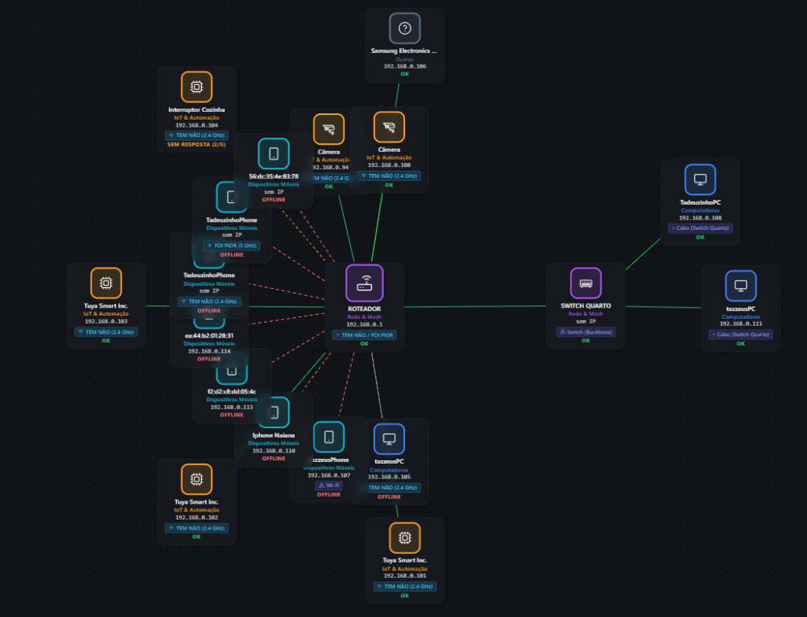
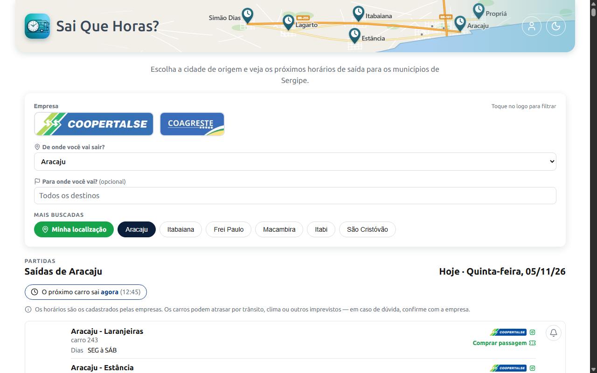
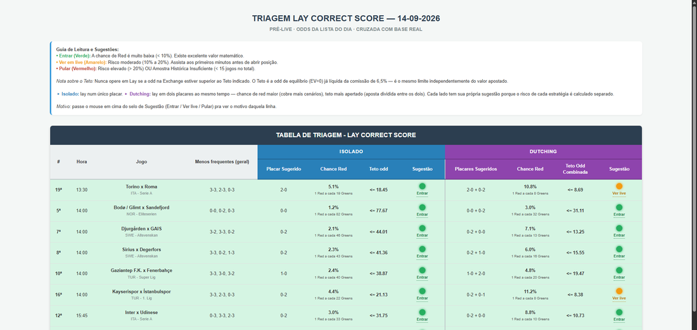
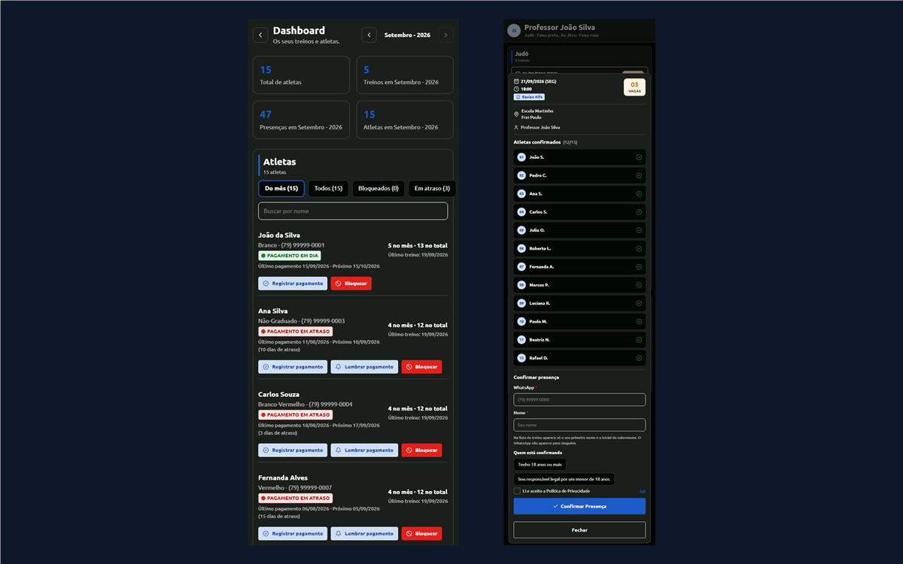
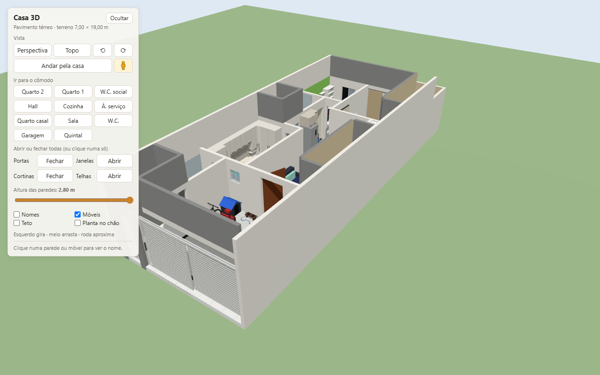
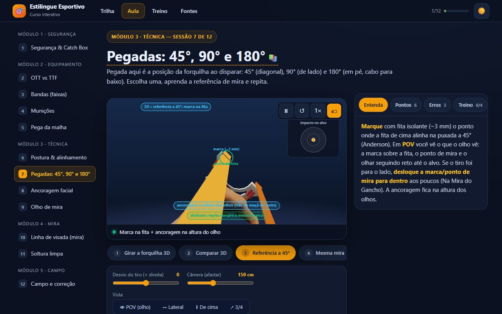
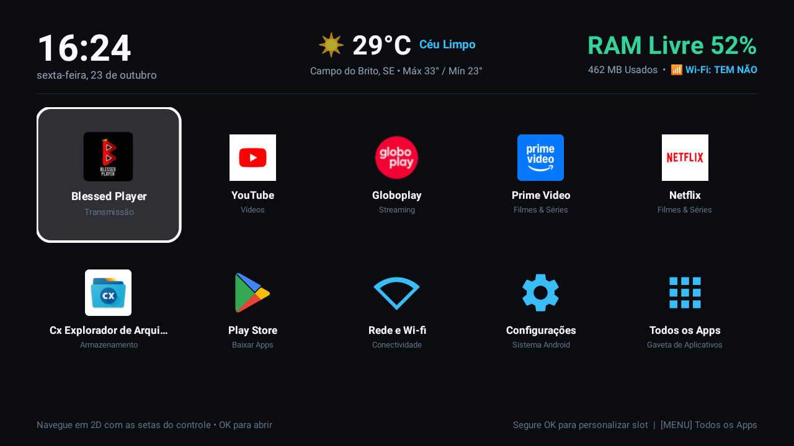
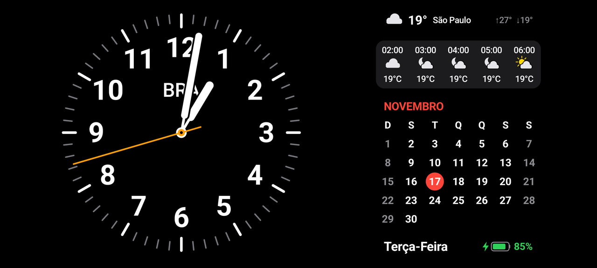
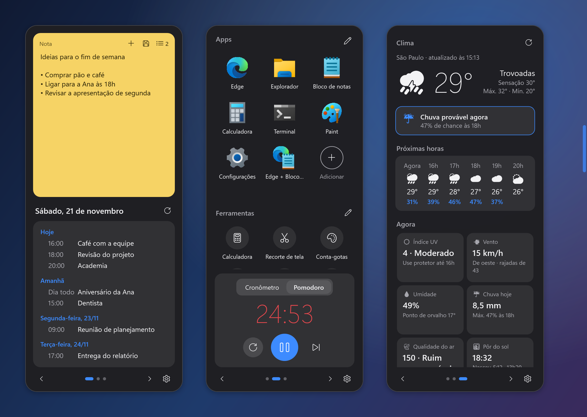

# Tadeu Reinaldo (@tazzeus) 👋

Desenvolvedor de Software focado em sistemas, plataformas escaláveis e engenharia agentic com inteligência artificial.

---

### 🚀 Projeto Open-Source em Destaque
- 📦 **[gerar-fluxograma](https://www.npmjs.com/package/gerar-fluxograma)** — Compilador CLI oficial no NPM para geração de fluxogramas BPMN interativos e animados em SVG puro com Tailwind CSS, projetado para desenvolvedores e agentes de IA.

---

### 💼 Projetos em Produção (Portfólio Corporativo)

| Projeto | Demonstração | Domínio / Solução | Stack Tecnológica | Status | README |
| :--- | :---: | :--- | :--- | :--- | :--- |
| **VIG-LAN** |  | Sistema autônomo de monitoramento e inventário contínuo de rede local (estilo Nagios/Zabbix) operando 24/7 sem privilégios admin via Win32 API, com mapa topológico interativo (React Flow), fingerprinting de dispositivos, central de intrusos e firewall integrado | Python 3.12, FastAPI, SQLite, React, TypeScript, React Flow, Vite, Win32 API (`iphlpapi`), WinSW | `[🔒 Código Proprietário]` | [📄 Ver](https://tazzeus.github.io/tazzeus/vig-lan.html) |
| **Sai que horas?** |  | Agregador de horários de transporte intermunicipal de Sergipe, com painel para cada empresa administrar a própria grade | Next.js, TypeScript, PostgreSQL (pgvector), Expo/React Native, Python | [🌐 No ar](https://sai-que-horas.vercel.app) · `[🔒 Código Proprietário]` | [📄 Ver](https://tazzeus.github.io/tazzeus/sai-que-horas.html) |
| **Co-Trader** |  | Plataforma de análise quantitativa, triagens de mercado e backtesting estatístico | Python, Pandas, FastAPI, SQLite | `[🔒 Código Proprietário]` | [📄 Ver](https://tazzeus.github.io/tazzeus/co-trader.html) |
| **Bora Treinar** |  | Plataforma de gestão de treinos de alta performance | React Native, TypeScript, Node.js | `[🔒 Código Proprietário]` | [📄 Ver](https://tazzeus.github.io/tazzeus/bora-treinar.html) |
| **Casa 3D** |  | Modelagem arquitetônica interativa 3D de residência a partir de planta baixa, com tour em primeira pessoa (walkthrough com detecção de colisões), interações dinâmicas de esquadrias e bundle autônomo em arquivo único | Three.js, WebGL, JavaScript (ES Modules), HTML5 Canvas, Node.js | `[🔒 Código Proprietário]` | [📄 Ver](https://tazzeus.github.io/tazzeus/casa-3d.html) |
| **Estilingue** |  | Plataforma didática interativa de tiro esportivo (*slingshot*) com 16 sessões, 53 animações (40 cenas 3D interativas em WebGL com órbita e fallback em Canvas), suporte bilíngue (PT-BR/EN) e execução offline em arquivo único | Three.js, WebGL, Canvas API, JavaScript (Vanilla ES Modules), HTML5, CSS3, SDD | `[🔒 Código Proprietário]` | [📄 Ver](https://tazzeus.github.io/tazzeus/estilingue.html) |
| **Otimizar TV Box** |  | Launcher nativo para Android TV (Kotlin) e suíte de otimização de performance via ADB (tuning de kernel/RAM sem root) para Smart Box com hardware restrito, eliminando travamentos e latência do controle remoto | Android TV, Kotlin, Android SDK, Gradle, ADB, Shell Script / PowerShell, Open-Meteo API | `[🔒 Código Proprietário]` | [📄 Ver](https://tazzeus.github.io/tazzeus/otimizar-tv-box.html) |
| **screen_charging** |  | Relógio de cabeceira para Android no estilo do modo de espera do iPhone: abre sozinho 10 s após conectar o carregador (até com o celular bloqueado), com relógio analógico, calendário, clima com previsão das próximas 5 horas, bateria e modo noturno automático; redesenha só os ponteiros a cada quadro para ficar ligado a noite toda gastando o mínimo de bateria | Android, Kotlin, Canvas API, Foreground Service, DreamService, Open-Meteo API | `[🔒 Código Proprietário]` | [📄 Ver](https://tazzeus.github.io/tazzeus/screen-charging.html) |
| **Painel Edge** |  | Painéis laterais deslizantes para o Windows no estilo dos Painéis Edge dos celulares Galaxy: uma alça na borda de cada monitor abre nota adesiva, agenda do Google ou Outlook, apps favoritos, ferramentas rápidas, cronômetro com Pomodoro e clima completo; roda em segundo plano, inicia com o Windows faz backup na nuvem do próprio usuário e se atualiza sozinho ([⬇️ baixar](https://github.com/tazzeus/painel_edge-releases/releases/latest)) | C#, .NET 10, WPF, Win32 API, OAuth 2.0 (PKCE), Google Calendar e Drive API, Microsoft Graph, Ical.Net, Open-Meteo API, Inno Setup | `[🔒 Código Proprietário]` | [📄 Ver](https://tazzeus.github.io/tazzeus/painel-edge.html) |

---

### 🛠️ Tecnologias & Stacks
- **Linguagens:** TypeScript, JavaScript (Node.js), Python, Kotlin, C#
- **Frontend & Visualização:** React, Next.js, Tailwind CSS, Three.js, WebGL, Canvas API, React Flow, SVG Nativo, HTML5 SPA, React Native (Expo), PWA, Android TV, WPF (Windows Desktop)
- **Backend & Dados:** Python, Node.js, .NET 10, FastAPI, SQLite, PostgreSQL (pgvector), Prisma, Pandas, SQLAlchemy, Alembic, Win32 API (`iphlpapi`)
- **DevOps, Mobile & IA:** NPM Packaging, Antigravity AI, Agentic Workflows, Git / GitHub, ADB / Android SDK, WinSW (Windows Services), SDD (Spec-Driven Development), OAuth 2.0 (PKCE), Inno Setup (Instaladores Windows)

---
📫 **Contato:** Conecte-se comigo pelo GitHub [@tazzeus](https://github.com/tazzeus) | [Instagram](https://www.instagram.com/tazzeus/) | [Email](mailto:tazzeus@gmail.com)
